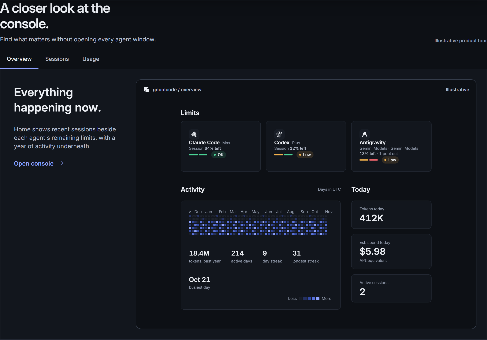

# Gnomcode

**Local-first runtime and mission control for Claude Code, Codex, and Antigravity.**

Launch official AI coding agent CLIs in one workspace, track usage and quota windows with explicit trust labels, compile cross-vendor handoff briefings when an agent hits a limit, and approve prompts from your phone over an end-to-end encrypted relay. Everything runs locally on your machine — no account required, no telemetry.

<p align="center">
  <a href="https://gnomcode.vercel.app">Website</a> &middot;
  <a href="https://gnomcode.vercel.app/downloads">Downloads</a> &middot;
  <a href="https://gnomcode.vercel.app/docs">Documentation</a> &middot;
  <a href="https://github.com/mwahaj36/gnomcode/releases">Releases</a>
</p>

<p align="center">
  <a href="https://github.com/mwahaj36/gnomcode/actions/workflows/ci.yml"></a>
  <a href="https://github.com/mwahaj36/gnomcode/releases"></a>
  <a href="https://www.npmjs.com/package/gnomcode"></a>
  <a href="LICENSE"></a>
</p>

<p align="center">
  
</p>

---

## Install

**v1.2.1** gives every button, select and panel one consistent look across the website, web console, Remote and desktop app, recolors the Gnomcode mark blue everywhere, and redesigns the Remote desktop panel. Download the desktop app for your platform from [Downloads](https://gnomcode.vercel.app/downloads) or the [v1.2.1 release assets](https://github.com/mwahaj36/gnomcode/releases/tag/v1.2.1); see the [changelog](https://gnomcode.vercel.app/changelog) for details. Windows installers are unsigned and macOS apps are unnotarized; Windows automatic updates verify an Ed25519-signed manifest before installing.

### npm (Windows, macOS, Linux)

```sh
npm install -g gnomcode
```

### macOS & Linux

```sh
curl -fsSL https://gnomcode.vercel.app/downloads/install.sh | bash
```

Desktop ZIPs are available for macOS Intel/Apple Silicon and Linux x64, with a Debian/Ubuntu `.deb` installer. On Alpine/musl, use npm or the static musl archive; the shell installer currently targets glibc Linux. CLI tarball archives (`darwin-aarch64`, `darwin-x86_64`, `linux-x86_64`, `linux-aarch64`, `linux-x86_64-musl`) and `SHA256SUMS` are also published on the [Releases page](https://github.com/mwahaj36/gnomcode/releases) and [Downloads](https://gnomcode.vercel.app/downloads).

### Windows

Download `Gnomcode-Setup.exe` or `Gnomcode-v1.2.1-windows-x64.zip` from [Releases](https://github.com/mwahaj36/gnomcode/releases) or [Downloads](https://gnomcode.vercel.app/downloads), or run:

```powershell
irm https://gnomcode.vercel.app/downloads/install.ps1 | iex
```

---

## Quick start (under a minute, no account)

1. Install and sign in to at least one official agent CLI yourself (`claude`, `codex`, or `agy`). Gnomcode never stores or replaces your vendor credentials.
2. Start the local console:
   ```sh
   gnomcode console
   ```
   The daemon binds to `127.0.0.1` only and opens the console in your browser.
3. Choose a project folder and an agent, finish any initial CLI trust/login prompt in the workspace terminal, and start chatting.
4. Run `gnomcode doctor` to inspect detected CLIs, log roots, and every outbound endpoint the daemon can reach.

---

## CLI reference

| Command | Purpose |
| :--- | :--- |
| `gnomcode console` | Start the local daemon and open the web console (`127.0.0.1`) |
| `gnomcode launch <agent> --repo <path>` | Launch `claude-code`, `codex`, or `antigravity` under a managed PTY |
| `gnomcode doctor` | Verify installed CLIs, log directories, and network rules (`--network`) |
| `gnomcode integrate <agent>` | Install optional fail-open hooks (`--remove` to revert cleanly) |
| `gnomcode remote` | Pair a phone or remote browser over the E2E-encrypted relay |

---

## Supported agents

| Agent | Observe sessions, usage, quota | Launch and resume | Approve prompts remotely | Handoff target |
| :--- | :--- | :--- | :--- | :--- |
| **Claude Code** | Yes | Yes | Yes | Yes |
| **Codex** | Yes | Yes | Opt-in protocol mode | Yes |
| **Antigravity** | Yes | Yes | Opt-in protocol mode | Yes |

What works in practice depends on your installed CLI version, authentication state, and provider entitlements. Log observation is the most complete path; hosted control and model-switch behavior are actively hardened against CLI updates.

## Platforms

| Platform | Distribution | Status |
| :--- | :--- | :--- |
| **Windows x64** | Setup `.exe`, portable ZIP, `install.ps1`, npm | Verified locally & in CI (unsigned installer) |
| **Windows ARM64** | CLI ZIP, npm | Static-runtime CLI; native ARM64 packed-install smoke tested |
| **macOS (arm64, x64)** | Desktop ZIP, CLI `.tar.gz`, `install.sh`, npm | Built & smoke-tested in CI; unnotarized (Gatekeeper) |
| **Linux (x64, arm64)** | x64 desktop ZIP/DEB; CLI `.tar.gz`, `install.sh`, npm | Built & smoke-tested in CI; live DE tray/Wayland unverified |

Linux x64 musl is also available as a static CLI archive and npm package. npm registry publication is separate from GitHub release publication; check the npm version badge for the published version.

See [docs/PLATFORMS.md](docs/PLATFORMS.md) for the full verification matrix and known platform gaps.

---

## Key capabilities

- **Launch, chat, and terminal separation** — run official CLIs inside a managed PTY with paged, redacted local history and a dedicated workspace terminal sheet.
- **Cross-vendor handoff** — compile a bounded briefing (objective, changed files, recent activity) so another agent can pick up the task when your current quota runs out. No extra LLM call is used to generate the briefing.
- **Usage and quota with trust labels** — every token count, API-equivalent cost estimate, and quota window declares its trust level (`exact`, `estimated`, `api`, `unknown`). Estimates are never presented as exact.
- **Encrypted Remote** — pair a phone or browser over an end-to-end encrypted relay to monitor sessions, send prompts, inspect files/diffs, and answer tool approvals.
- **Guardrails and auto-routing** — local budget rules, loop detection, scheduled prompts, and quota-aware fallback routing. Hard-stop enforcement is Claude-specific and fails open.

---

## Privacy and security invariants

- **Loopback only:** Local HTTP/WS servers bind strictly to `127.0.0.1` and require a bearer token plus `Host`/`Origin` validation.
- **No telemetry:** No analytics and no phone-home. Run `gnomcode doctor --network` to inspect allowed outbound endpoints (opt-out update manifest, opt-in vendor quota/pricing refresh, and opt-in E2E relay).
- **Redacted local history:** Activity summaries pass through `core::redact` before SQLite persistence; agent-owned logs (`~/.claude`, `~/.codex`, `~/.gemini`) are read-only and never modified.
- **Never escalate permissions:** Gnomcode never passes `--dangerously-skip-permissions`, `--yolo`, or equivalent flags.
- **Fail open:** Hooks use a 50 ms IPC timeout and never block an agent CLI if the daemon is stopped or slow.

---

## Architecture

Business logic lives in Rust (`crates/`); TypeScript (`web/` and `apps/desktop/`) handles presentation and shell integration only.

```text
crates/
├── core        Pure domain types, pricing, quota math, routing, redactor (no I/O)
├── adapters    Deterministic parsers for Claude Code, Codex, and Antigravity logs
├── store       SQLite schema, migrations, and rollups
├── platform    OS paths, process scan, window focus, autostart, sleep inhibition
├── pty         Managed PTY host and prompt/limit state detection
├── ingest      Filesystem watcher, reconciler, and checkpoints
├── daemon      axum HTTP/WS API, IPC server, relay client, automation scheduler
└── cli         Thin `gnomcode` binary entrypoint

web/            Next.js marketing site, local console bundle, and encrypted Remote PWA
apps/desktop/   Electron tray shell
```

Dependency direction: `core` <- `adapters`, `store`, `platform`, `pty` <- `ingest` <- `daemon` <- `cli`.

---

## Contributing and development

Gnomcode is licensed under the [Apache License 2.0](LICENSE). Contributions are welcome — see [docs/CONTRIBUTING.md](docs/CONTRIBUTING.md) (DCO sign-off required), [SECURITY.md](SECURITY.md), and [CODE_OF_CONDUCT.md](CODE_OF_CONDUCT.md). Additional docs: [docs/PRODUCT.md](docs/PRODUCT.md), [docs/comparison.md](docs/comparison.md), and [AGENTS.md](AGENTS.md).

Run the Rust quality gate locally:

```sh
cargo fmt --all --check
cargo clippy --workspace --all-targets -- -D warnings
cargo test --workspace
cargo deny check
```

For the web console and desktop shell (`web/` and `apps/desktop/`), run `npm ci` followed by `npm test`.
