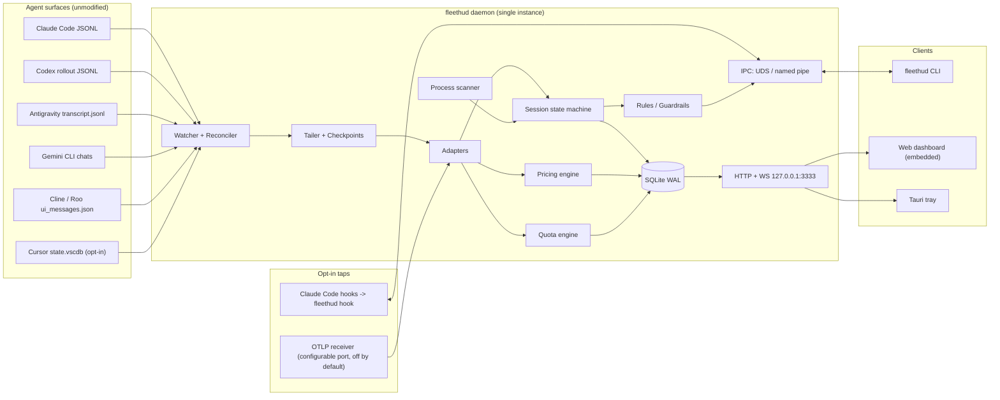
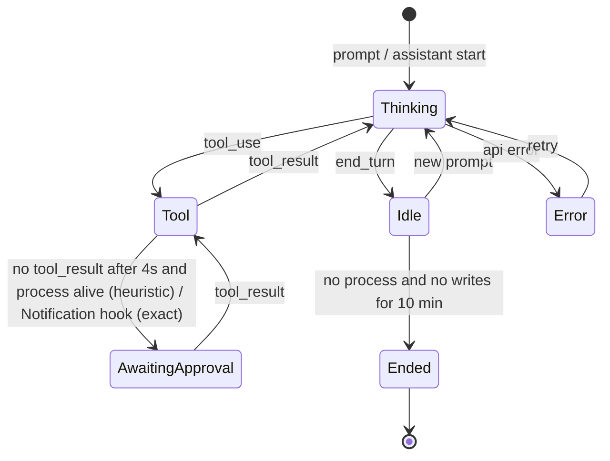
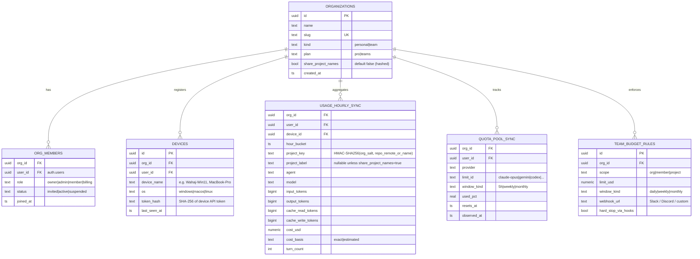
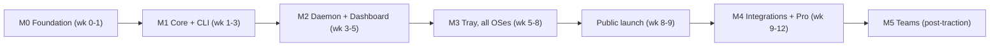

# FleetHUD — Specification, Roadmap & Delivery Plan

> **This file is the single source of truth for FleetHUD.**
> Product scope, architecture, roadmap, deliverables and deployment all live here.
> If code, issues or other docs disagree with this file, this file wins — or it gets updated in the same PR.
> Architectural decisions are recorded as ADRs in [`docs/adr/`](./adr/) and summarized here.

| Field | Value |
| :--- | :--- |
| Status | Pre-M0 (scaffolding) |
| Last updated | 2026-10-26 |
| Owner | Wahaj (@mwahaj36) |
| Domain | `fleethud.pro` |
| License | Proprietary, closed source. Free tier is freeware; Pro and Teams are paid. Source repo is private. |

---

## 1. Product

### 1.1 One-liner

**FleetHUD is live mission control for every AI coding agent on your machine** — see which agents are running, which are blocked waiting for you, what they cost, and how close you are to your limits. Windows, macOS and Linux. Zero config. Nothing leaves your laptop.

### 1.2 Problem

Developers run a fleet of agents at once (Claude Code, Codex, Antigravity, Gemini CLI, Cline/Roo, Cursor). Each is a silo. Nobody can answer at a glance:

1. *Which of my agents is stuck waiting for approval right now?*
2. *What is each agent doing right now?*
3. *How much did this repo cost me this week, across all agents?*
4. *When will I hit my 5-hour / weekly limit?*
5. *Is something burning money in a loop while I'm away?*

### 1.3 Positioning vs. alternatives

| Tool | What it does | Gap FleetHUD fills |
| :--- | :--- | :--- |
| CodexBar | Free macOS menubar for quotas & cost, 60+ providers | macOS only; quotas, not live agent state; no guardrails |
| ccusage & similar | CLI reports from Claude/Codex logs | After-the-fact, no live state, no tray |
| Vendor dashboards | Per-vendor usage | Siloed, no cross-agent / per-project view |

**Differentiators (in priority order):**
1. **Live cross-agent session state** — thinking / running tool / *awaiting approval* / idle / error.
2. **Windows + Linux as first-class**, not afterthoughts.
3. **Guardrails that act** (Pro) — stop runaway loops via agent hooks.
4. **Per-project ledger across agents.**

### 1.4 Target users

- **Primary:** individual developers running 2+ agents daily on subscriptions (Claude Pro/Max, ChatGPT Plus/Pro, Google AI plans).
- **Secondary:** API pay-as-you-go users who need cost visibility and runaway protection.
- **Later:** small teams wanting aggregate spend visibility (no code shared).

### 1.5 Tiers

| | **Free (freeware, forever)** | **Pro — \$19 one-time** | **Teams — \$12/seat/mo (later)** |
| :--- | :--- | :--- | :--- |
| CLI reports, daemon, local web dashboard | ✅ | ✅ | ✅ |
| Tray / menubar app (all 3 OSes) | ✅ | ✅ | ✅ |
| Live session state, activity feed | ✅ | ✅ | ✅ |
| Quota tracking & reset notifications | ✅ | ✅ | ✅ |
| Approval-needed notifications | ✅ | ✅ | ✅ |
| Bring-to-front window switcher | ✅ | ✅ | ✅ |
| **Guardrails** (budget / loop auto-stop via hooks) | — | ✅ | ✅ |
| **Custom alert rules** (spend, context bloat, idle-awaiting) | — | ✅ | ✅ |
| **Resume Queue** (auto-continue rate-limited agents at quota reset, §3.14) | — | ✅ | ✅ |
| **Advanced analytics & CSV/JSON export** | — | ✅ | ✅ |
| **Personal multi-machine sync** | — | ✅ | ✅ |
| Team dashboard, Slack/Discord alerts, team caps | — | — | ✅ |

**Licensing model:** FleetHUD is **closed source**. The source repo is private, and only compiled binaries are distributed, under an End User License Agreement (EULA). One binary covers every tier: Pro features are compiled in and unlocked by an offline **Ed25519-signed license file** (see §6.6).

**Trust without open source.** FleetHUD reads sensitive agent logs, so closed source has to be balanced with verifiable privacy:
- No network access by default, apart from the opt-out update check.
- `fleethud doctor --network` lists every outbound endpoint the build can contact.
- A published privacy policy.
- Third-party license notices bundled with every release.

### 1.6 Non-goals

- Not an API proxy. We never sit in the request path.
- Not an enterprise APM. No SDK instrumentation required.
- We never store prompts, code, file contents or tool output.
- No product telemetry / phone-home. Ever. (Update checks are opt-out and send only the version.)
- No remote/SSH/devcontainer agent tracking before v1.0 (WSL is supported).

### 1.7 Success metrics (first 6 months after public launch)

| Metric | Target |
| :--- | :--- |
| GitHub stars | 1,500 |
| Weekly npm + release downloads | 2,000 |
| Pro licenses sold | 150 |
| Adapter parse-error rate (from `fleethud doctor` reports) | < 0.5% of lines |
| Daemon idle footprint | < 30 MB RSS, < 1% CPU |

---

## 2. Supported agents

Verified against real files on 2026-10-26 unless marked *(verify)*.

| Agent | Tier | Source | Tokens | Model | Quota | Live state |
| :--- | :--- | :--- | :--- | :--- | :--- | :--- |
| **Claude Code** (CLI + IDE) | A | `~/.claude/projects/**/*.jsonl`, `~/.config/claude/projects`, `$CLAUDE_CONFIG_DIR` | exact (incl. 5m/1h cache-write split) | ✅ | estimated (opt-in: API) | heuristic → exact with hooks |
| **Codex CLI** | A | `$CODEX_HOME/sessions/YYYY/MM/DD/rollout-*.jsonl` (default `~/.codex`) | exact (`last_token_usage`) | ✅ | **exact** (`rate_limits` 5h + weekly) | heuristic |
| **Antigravity** (app / IDE / CLI) | A | `~/.gemini/antigravity/brain/<id>/.system_generated/logs/transcript.jsonl` | exact per `PLANNER_RESPONSE` | ✅ extracted from `<USER_SETTINGS_CHANGE>` tags in `USER_INPUT` steps | per-model pool (`limit_id` per model family: Claude, Gemini, Fable, etc.) | heuristic |
| **Gemini CLI** | B | `~/.gemini/tmp/<hash>/chats/` *(verify)* | *(verify)* | *(verify)* | unknown | heuristic |
| **Cline / Roo Code** | B | `<editor>/User/globalStorage/{saoudrizwan.claude-dev,rooveterinaryinc.roo-cline}/tasks/<id>/ui_messages.json` | exact (`api_req_started`) | ✅ | n/a (API) | heuristic |
| **Cursor** | C (experimental, opt-in) | `Cursor/User/globalStorage/state.vscdb` + undocumented usage API | partial | partial | api (fragile) | ❌ |
| **Aider** | C (opt-in) | `--analytics-log <file>` | exact | ✅ | n/a | ❌ |

**Tier A** = must work at launch. **Tier B** = ships in M4. **Tier C** = experimental, off by default, labeled as such in the UI.

Editor roots for Cline/Roo are probed across `Code`, `Code - Insiders`, `Cursor`, `Windsurf`, `VSCodium` under `%APPDATA%` (Win), `~/Library/Application Support` (mac), `~/.config` (Linux).

---

## 3. Architecture

### 3.1 Principles

1. **Read-only by default.** Agent configs are only modified by explicit `fleethud integrate <agent>`, with backup and `--remove`.
2. **Metadata, not content.** Counts, timings, tool names, redacted ≤120-char summaries.
3. **Every number carries its trust level:** `exact | estimated | api | unknown`.
4. **One Rust core, many shells:** CLI, daemon, hook handler and tray share crates.
5. **Correctness doesn't depend on FS watchers.** Watchers are a latency optimization; a reconciler guarantees completeness.
6. **Graceful per-OS degradation.** Unsupported features fall back, never crash.
7. **Fail open.** If FleetHUD is down, agents behave exactly as without it.

### 3.2 Component diagram



### 3.3 Process model

| Component | Tech | Role |
| :--- | :--- | :--- |
| `fleethud` | Rust single binary | Subcommands: `daemon`, `status`, `report`, `hook <event>`, `integrate <agent>`, `doctor`, `install`, `uninstall`, `open` |
| daemon (`fleethud daemon`) | tokio + axum + rusqlite | Owns watchers, DB, API. Single instance via lockfile + port probe. |
| Web dashboard | React + Vite + Tailwind, embedded via `rust-embed` | Served at `http://127.0.0.1:3333` |
| Tray app | Tauri v2 | Thin client of the daemon API; spawns the daemon as a sidecar if absent; reuses the web bundle. |

**FleetHUD home:** `~/.fleethud/` on all OSes (override: `FLEETHUD_HOME`). Contains `fleethud.db`, `daemon.json` (port + token, user-only perms), `ipc.sock` (Unix), `config.toml`, `pricing.toml`, `license.json`, `bin/`, `logs/`.

### 3.4 Workspace layout

```
fleethud/
├─ crates/
│  ├─ core/        # domain types, pricing, quota, rules, redactor — no I/O
│  ├─ adapters/    # one module per agent; pure parse(bytes) -> events
│  ├─ ingest/      # watcher, reconciler, tailer, checkpoints
│  ├─ store/       # SQLite schema, migrations, queries, rollups
│  ├─ platform/    # paths, process scan, window focus, autostart (cfg(target_os))
│  ├─ daemon/      # axum HTTP/WS API, IPC server, orchestration
│  └─ cli/         # `fleethud` binary
├─ apps/tray/      # Tauri v2 shell                      (M2)
├─ web/            # React dashboard                     (M1)
├─ npm/            # npm shim + per-platform packages
├─ fixtures/       # anonymized real agent logs per agent/version
└─ docs/           # SPEC.md (this), adr/
```

**Dependency rule:** `core` depends on nothing internal. `adapters` → `core`. `store` → `core`. `ingest` → `core`, `adapters`, `store`. `platform` → `core`. `daemon` → everything except `cli`. `cli` → `daemon` (+ others as needed). No cycles, no reaching "up".

### 3.5 Ingestion

**Adapter contract** (in `crates/adapters`):

```rust
pub trait SourceAdapter: Send {
    fn id(&self) -> AgentId;
    fn discover(&self, env: &PlatformEnv) -> Vec<WatchRoot>;
    fn file_kind(&self, path: &Path) -> Option<FileKind>; // AppendOnlyJsonl | RewrittenJson | Sqlite
    fn parse(&mut self, ctx: &FileCtx, chunk: &[u8]) -> Vec<RawEvent>; // pure, no I/O
}
```

| Adapter | Dedup key | Gotchas |
| :--- | :--- | :--- |
| Claude Code | `message.id + requestId` | One message is written once per content block; resumed sessions copy history. `isSidechain` = subagent. |
| Codex | `session_id + ordinal` | Use `last_token_usage` deltas, not cumulative totals. `rate_limits` = exact quota. |
| Antigravity | `conversation_id + step_index` | Model is tracked as a state variable updated by `<USER_SETTINGS_CHANGE>` tags in `USER_INPUT` steps (`Model Selection` -> e.g. `Claude Opus 5.5 (Medium)`, `Gemini 4 Argon (Medium)`). Subagents = `invoke_subagent` tool calls. Titles from `conversation_summaries.db` (read-only). |
| Cline / Roo | `task_id + ts` | File is rewritten whole → re-read + diff, debounce 500 ms. |
| Cursor | — | Open SQLite with `mode=ro&immutable=1` or copy first. |

**Tailer rules:**
- File identity: `(dev, inode)` on Unix; volume serial + file index on Windows. Identity change or `size < offset` ⇒ restart from 0 (dedup keeps it idempotent).
- Windows: open with `FILE_SHARE_READ | FILE_SHARE_WRITE | FILE_SHARE_DELETE`; never hold handles while idle.
- Only complete lines are parsed; the trailing partial line stays buffered.
- Events and checkpoint commit in **one SQLite transaction**.
- Watcher (`notify` crate, 150 ms debounce) + **reconciler** (30 s scan of recently modified files) to survive FSEvents coalescing, `IN_Q_OVERFLOW`, `ReadDirectoryChangesW` overflow.
- Linux: watch narrowly (e.g. Codex: today + yesterday dirs), fall back to polling on watch-limit errors, report in `doctor`.
- WSL: detect distros (`wsl -l -q`), **poll** `\\wsl$\<distro>\home\*\.{claude,codex,gemini}` every 2 s.
- Backfill: streaming parse, skip large fields (`serde::de::IgnoredAny`).

### 3.6 Data model

| Table | Key | Purpose |
| :--- | :--- | :--- |
| `project` | `id = hash(repo_root)` | repo root, display name, last branch |
| `session` | `id = "<agent>:<native_id>"` | agent, surface, project, parent session, title, state, pid, started/last event |
| `usage_record` | `dedup_key` | ts, model, input, output, reasoning, cache_read, cache_write_5m, cache_write_1h, context_tokens, cost_usd, cost_basis, pricing_version |
| `activity_event` | autoinc | ts, kind (`prompt/tool_start/tool_end/approval_wait/error/subagent/rate_limited/auto_resume`), tool_name, summary_redacted, duration_ms |
| `quota_snapshot` | `(provider, limit_id, window, observed_at)` | `limit_id` (e.g. `codex`, `premium`, `claude-opus`, `gemini`, `fable`), used_pct, resets_at, plan, basis |
| `source_file` | `path` | file identity, offset, partial-line buffer, adapter version |
| `usage_daily` | `(day, project, agent, model)` | rollup |
| `rule`, `alert` | autoinc | Pro rules & fired alerts |
| `resume_queue` | `session_id` | armed sessions: agent, cwd, resume_prompt, max_runs, runs, order, strategy used, status |

Retention defaults: `usage_record` 180 days → rolled into `usage_daily`; `activity_event` 30 days.

**Derived values:**
- Context size — Claude: `input + cache_read + cache_write` of latest turn; Codex: `last_token_usage.input_tokens / model_context_window`; Antigravity: `input_tokens`. Bloat warning at > 70% of window.
- Plan value — Σ API-equivalent cost per billing window ÷ plan price.

### 3.7 Session state machine



Liveness = log recency + **process scanner** (`sysinfo`, every 3 s, matches agent processes to sessions by `cwd`) + hook events when integrated.

**Redactor:** strips token-like strings (`sk-…`, `ghp_…`, `AKIA…`, `xox?-…`, JWTs, high-entropy > 32 chars), env assignments, then truncates to 120 chars. Applied **before** anything is written to disk.

### 3.8 Pricing engine

- Bundled snapshot of LiteLLM `model_prices_and_context_window.json`, tagged `pricing_version`; optional daily refresh; user overrides in `pricing.toml`.
- Cache writes priced by TTL (5m vs 1h).
- Subscription surfaces display **"API-equivalent"**, never "spent".
- Raw tokens are always stored so history can be re-priced.

### 3.9 Quota engine (multi-pool / per-model limits)

Providers do not have a single monolithic limit — they maintain **separate quota pools per model family or tier** (`limit_id`) within the same subscription:
- **Antigravity:** separate quota pools and reset windows per model family (e.g., Claude Opus / Sonnet vs. Gemini / Argon vs. Fable). Hitting the limit on Claude inside Antigravity does not lock out Gemini, and each pool resets independently.
- **Codex:** emits `rate_limits.limit_id` directly in the log (e.g., `"codex"` vs. `"premium"`), each with its own `primary` (5h) and `secondary` (weekly) windows.
- **Claude Code:** separate rolling/weekly pools by model tier (e.g., Opus vs. Sonnet) on Pro/Max plans.
- **Cursor:** separate pools by model bucket / fast-request tier.

Every quota record and UI meter is keyed by `(provider, limit_id, window)`:

| Provider | `limit_id` pools | Source | Basis |
| :--- | :--- | :--- | :--- |
| Codex | `rate_limits.limit_id` (`codex`, `premium`, …) | `rate_limits.primary/secondary` in rollout JSONL | exact |
| Antigravity | Model family from `<USER_SETTINGS_CHANGE>` (`claude`, `gemini`, `fable`, …) | Per-pool rolling window + rate-limit event detection; user-configurable pool limits | estimated |
| Claude (subscription) | Model tier (`opus`, `sonnet`, `haiku`, `all`) | 5h rolling blocks + weekly window per model tier | estimated |
| Claude (opt-in) | Per-tier buckets from API | unofficial OAuth usage endpoint with local credentials | api |
| Cursor (opt-in) | Per-model bucket | dashboard usage API | api |
| Gemini CLI | Model family | burn velocity + user-configurable pool limits | estimated / unknown |

- **Per-pool notifications & Resume Queue:** Quota alerts and Resume Queue (§3.14) trigger on the specific `(provider, limit_id)` pool that restricted the session (e.g., *"Antigravity · Claude Opus 5.5 limit reset — resuming 2 sessions"*), or optionally suggest switching models when one pool is exhausted while sibling pools have headroom.
- **Lockout ETA:** EWMA burn over 15 min per `(provider, limit_id)` projected to 100%; shown only when the confidence band is narrow.

### 3.10 Guardrails (Pro)

| Agent capability | Action on breach |
| :--- | :--- |
| Claude Code with hooks integrated | Daemon sets a block flag → next `PreToolUse` hook exits `2` with a reason → agent halts gracefully |
| Standalone CLI process (Codex, Gemini, Aider) | SIGINT on Unix; on Windows notify and terminate only after user confirmation |
| IDE-hosted (Cline, Antigravity, Cursor) | Notification only — never kill the editor |

- `fleethud integrate claude` adds `PreToolUse`, `PostToolUse`, `Notification`, `Stop` hooks to `~/.claude/settings.json` (backup first; `--remove` restores).
- Hook ↔ daemon over IPC with a **50 ms timeout, fail-open**.
- Loop detection: hash `(tool_name, normalized args)`; fire on N repeats within a window.

### 3.11 Local API & security

- Bind **127.0.0.1 only**. Random bearer token in `daemon.json` (0600 / user-only ACL).
- Validate `Host` and `Origin` on every request (DNS-rebinding defense).
- IPC: `~/.fleethud/ipc.sock` (Unix), `\\.\pipe\fleethud-<user>` (Windows).
- Endpoints (v1): `GET /v1/sessions?active=1`, `GET /v1/usage?group=project|agent|model&from&to`, `GET /v1/quota`, `WS /v1/stream`, `POST /v1/sessions/:id/focus`, `GET|POST /v1/rules`, `GET /v1/health`.

### 3.12 Cross-platform matrix

| Concern | Windows | macOS | Linux |
| :--- | :--- | :--- | :--- |
| FS events | ReadDirectoryChangesW | FSEvents | inotify (+ polling fallback) |
| Process cwd | PEB via `sysinfo` | `proc_pidinfo` | `/proc/<pid>/cwd` |
| Tray | Notification area (onboarding "pin me" hint) | NSStatusItem + popover window | SNI/AppIndicator — **menu only**; GNOME needs extension; fallback mini-window |
| Notifications | Toast (AUMID set by MSI) | UNUserNotification (signed app) | freedesktop D-Bus |
| Autostart | `HKCU\…\Run` | SMAppService / LaunchAgent | XDG autostart / `systemd --user` |
| IPC | Named pipe | UDS | UDS |
| WSL agents | Poll `\\wsl$` | — | — |

### 3.13 Bring-to-front

Walk the agent PID's parent chain to a known host, then:

| Host | Windows | macOS | Linux X11 | Linux Wayland |
| :--- | :--- | :--- | :--- | :--- |
| VS Code / Cursor / Windsurf | `code -r <repo>` | same | same | same |
| Terminal window | `SetForegroundWindow` (we own foreground after tray click) | `NSRunningApplication.activate` | EWMH `_NET_ACTIVE_WINDOW` | KWin D-Bus / `swaymsg` / `hyprctl`; GNOME unsupported |
| Specific tab | Windows Terminal: not addressable | iTerm2 / Terminal.app via AppleScript by TTY | tmux `select-window` | tmux |

Unsupported → show a toast with the repo path and a "copy path" action.

### 3.14 Resume Queue — auto-continue at quota reset (Pro)

When an agent stops because it hit its rate limit, FleetHUD can continue it automatically once the window resets.

**Detection.** The adapter emits a `rate_limited` activity event with `resets_at`:
- Codex: `rate_limits.rate_limit_reached_type` plus `primary/secondary.resets_at` (exact).
- Claude Code: the usage-limit message in the JSONL, plus the quota engine's reset estimate *(verify the exact line format against fixtures)*.

**Arming is always explicit.** No session ever resumes unless the user armed it. They can arm per session (a tray or dashboard button on a rate-limited session) or per project (a rule). Each armed entry stores `{session_id, agent, cwd, resume_prompt (default "continue"), max_runs, order}`.

**Resume strategies**, tried in order per session:

| # | Strategy | Where it works | Result |
| :--- | :--- | :--- | :--- |
| 0 | **Agent-native auto-continue** | Claude Code ≥ 2.1.234 with `autoContinueAtUsageLimit` on and the session still open *(verify)* | FleetHUD does nothing except show "auto-resumes at HH:MM". No double prompts. |
| 1 | **Keystroke injection into the original terminal** | tmux (`tmux send-keys -t <pane>`) on all Unix systems; iTerm2 / Terminal.app via AppleScript matched by TTY | Resumes in the user's own window. Best UX. |
| 2 | **Headless resume in the background** | Any OS, when the original process is gone: `claude -p --resume <id> "<prompt>"`, `codex exec resume <id> "<prompt>"` | Runs in the background. Progress shows in the dashboard through the normal log ingestion. The user can reattach with `claude --resume <id>`. |
| — | **Notify only** | IDE-hosted agents (Antigravity, Cline/Roo, Cursor) and Windows Terminal tabs with a live process | Toast: "Limit reset — 3 sessions ready to continue" with a focus button. |

**Safety rules:**
- Never escalate permissions. Headless runs inherit the user's existing permission config and never pass `--dangerously-skip-permissions`, `--yolo` or similar flags. If a run hits a permission prompt, it stops and FleetHUD raises an "awaiting approval" notification.
- Wait for the reset plus a random 30–120 s, and confirm the reset where possible (a Codex `used_percent` drop) before resuming.
- Stagger the queue: resume sessions one at a time in the user's `order`, so they don't all burn the fresh window at once. Stop the queue when quota burn passes a user threshold.
- `max_runs` (default 1) stops resume loops. Every resume is recorded as an `activity_event` (`kind = auto_resume`).
- If the session's process is still alive and the agent supports native auto-continue, never inject keystrokes or start a second process for the same session.

### 3.15 Cloud Sync, Multi-Device & Organizations (Supabase)

Both **Pro (Personal Multi-Device Sync)** and **Teams (Organization Rollups & Budgets)** share a single Supabase backend (`Postgres` + `Auth` + `Row-Level Security` + `Edge Functions`), so we only build the sync infrastructure once.

#### A. Unified Multi-Tenant Schema

Every user gets a default **personal workspace** (`organizations.kind = 'personal'`, 1 member, unlimited devices) on Pro activation. Teams creates a **shared organization** (`kind = 'team'`, N seats, M devices per member).



#### B. Device Pairing & Auth Flow (`fleethud login`)
1. User runs `fleethud login` (or clicks **Connect Cloud** in the tray).
2. Daemon starts an OAuth 2.0 **Device Authorization Flow** (or localhost PKCE callback) against Supabase Auth (GitHub / Google / Magic Link).
3. On approval, a Supabase Edge Function mints a **scoped device token** (`fh_dev_...`), stores only `SHA-256(token)` in `devices`, and returns the raw token to the daemon (saved in `~/.fleethud/credentials.json` with `0600` / user-only ACL).
4. Users can revoke any lost laptop from the web dashboard (`DELETE /devices/:id`).

#### C. Sync Engine & Conflict-Free Idempotency
- **Push cadence:** Every 60 seconds (when online) and on graceful daemon shutdown, the daemon rolls up dirty local `usage_record` rows into `(device_id, hour_bucket, project_key, agent, model)` buckets and performs an **idempotent `UPSERT`** (`ON CONFLICT DO UPDATE`) to `usage_hourly_sync`.
- **Offline queue:** Local SQLite tracks `last_synced_hour`. If a laptop is offline for a week, the next connection flushes all missed hourly buckets in a single batch (< 50 KB).
- **Cross-device quota sharing (Pro killer feature):** Because `quota_pool_sync` is keyed by `(user_id, provider, limit_id)` rather than `device_id`, a developer switching from their Windows desktop to their MacBook immediately sees their live Claude/Codex/Antigravity quota countdown on the second machine even before running a turn there.

#### D. Privacy Boundary (What NEVER leaves the machine)
- **Zero content, zero file paths, zero activity summaries:** `activity_event` stays 100% local in SQLite.
- **Project name hashing:** By default, `project_key = HMAC-SHA256(org_salt, normalized_git_remote_or_folder_name)`. Team admins only see `proj_8f3a...` unless the member or org explicitly enables `share_project_names = true`.
- **Member transparency:** `fleethud sync status` shows the exact JSON payload queued for Supabase so engineers can verify nothing sensitive is uploaded to their manager's org.

#### E. Roles, Seat Billing & Team Guardrails
- **Roles enforced by Postgres RLS:**
  - `owner` / `admin`: manage members, seats, budgets, Slack/Discord webhooks, view org-wide and per-member rollups.
  - `member`: push from own devices, view own devices + org-level totals (cannot inspect other individual members unless enabled by admin).
  - `billing`: manage subscription and invoices only.
- **Seat management:** Lemon Squeezy / Paddle subscription quantity webhook → Supabase Edge Function updates `organizations.max_seats`. Inviting a member beyond `max_seats` increments the subscription seat count automatically (or prompts the owner).
- **Team-wide guardrails:** When a `team_budget_rules` threshold is breached, a Postgres trigger / Edge Function fires the Slack/Discord webhook and sets a flag in the device's sync response; if `hard_stop_via_hooks = true`, connected daemons enforce the block on the next `PreToolUse` hook.

---

## 4. Engineering standards (summary)

Full rules live in [`AGENTS.md`](../AGENTS.md). Key gates:

- `cargo fmt --check`, `cargo clippy --workspace --all-targets -- -D warnings`, `cargo test --workspace`, `cargo deny check` — green on **Windows, macOS, Linux** CI before merge.
- Every adapter change ships with a golden fixture test.
- Conventional Commits; one ADR per architectural decision.

---

## 5. Roadmap

Status legend: ⬜ not started · 🟨 in progress · ✅ done. Estimates assume one developer part-time with AI agents.



### M0 — Foundation (week 0–1) 🟨

| Deliverable | Exit criteria | Status |
| :--- | :--- | :--- |
| Repo scaffold: Cargo workspace, crates, lints, `rust-toolchain.toml`, `deny.toml` | `cargo check --workspace` passes | ✅ (scaffolded, pending first CI run) |
| `AGENTS.md`, workspace skills, ADRs, this SPEC | Present and linked from README | ✅ |
| CI on Windows/macOS/Linux (fmt, clippy, test, deny) | Green on `main` | ⬜ |
| Fixture corpus: anonymized Claude Code, Codex, Antigravity samples | ≥ 3 files per agent incl. resumed session + subagent | ⬜ |

### M1 — Core engine + CLI (weeks 1–3) ⬜

| Deliverable | Exit criteria |
| :--- | :--- |
| `core`: domain types, pricing engine with bundled LiteLLM snapshot, redactor | Unit tests; redactor property tests |
| `adapters`: Claude Code, Codex, Antigravity | Golden tests pass; dedup verified on resumed sessions |
| `ingest`: tailer + checkpoints + reconciler (no daemon yet) | Kill-mid-import test: no double counts |
| `store`: schema v1 + migrations | Migration test from empty DB |
| `fleethud report` (daily/weekly/project/agent/model) and `fleethud status` (one-shot live view) | Matches ccusage totals for Claude within 1% on same data |
| `fleethud doctor` | Lists detected agents, paths, parse-error rates |
| Distribution: npm per-platform packages + archives on `fleethud-releases` + shell/PowerShell installers + EULA and third-party notices bundled | `npx fleethud report` works on fresh Win/mac/Linux machines |

**Release:** `v0.1.0` — soft launch (r/ClaudeAI, r/ChatGPTCoding, X) for feedback.

### M2 — Daemon + live dashboard (weeks 3–5) ⬜

| Deliverable | Exit criteria |
| :--- | :--- |
| `daemon`: single-instance, watchers, process scanner, session state machine | Session states correct across 5 concurrent agents in manual test |
| HTTP + WS API with token + Host/Origin checks | Security tests for rebinding and missing token |
| Web dashboard (embedded): live sessions, activity feed, cost by project/agent/model, context gauge, quota cards | Lighthouse-free; works offline |
| Quota engine (Codex exact, Claude estimated) | Codex values match CLI `/status` |
| `fleethud install` / `uninstall` (stable binary + autostart per OS) | Survives reboot on all 3 OSes |
| WSL polling | Claude Code inside WSL appears on Windows host |

**Release:** `v0.2.0`.

### M3 — Tray app on all OSes (weeks 5–8) ⬜

| Deliverable | Exit criteria |
| :--- | :--- |
| Tauri v2 tray: status pill (active count, awaiting-approval badge, burn), popover/mini-window | Works on Win 11, macOS 14+, Ubuntu 24.04 GNOME, Fedora KDE |
| Notifications: approval needed, quota reset, context bloat | Fires within 5 s of event |
| Bring-to-front (per §3.13) | Matrix in §3.13 verified manually |
| Signed installers: notarized DMG, signed MSI, AppImage/deb/rpm | No Gatekeeper block; SmartScreen reputation accrues |
| Tauri auto-updater | Update from previous version end-to-end |
| Landing page on `fleethud.pro` | Live with download buttons per OS |

**Release:** `v0.5.0` → **public launch**: Show HN, Product Hunt, r/programming, X thread with demo GIF.

### M4 — Integrations + Pro (weeks 9–12) ⬜

| Deliverable | Exit criteria |
| :--- | :--- |
| `fleethud integrate claude` (hooks) → exact approval state | Install/remove round-trips `settings.json` byte-identical |
| Guardrails + loop detection (Pro) | Synthetic runaway stopped within 1 tool call |
| Resume Queue (Pro): rate-limit detection, arming UI, strategies 0–2 (§3.14) | An armed Codex and Claude session each resume once after a real reset; an unarmed session never resumes |
| Custom alert rules, CSV/JSON export (Pro) | — |
| Adapters: Gemini CLI, Cline/Roo; Cursor + Aider (experimental) | Golden tests |
| Licensing: checkout + signed license file + in-app activation | Offline verification works; refund revokes on next online check |
| OTLP receiver (opt-in, configurable port) | Claude Code OTel ingested |

**Release:** `v0.8.0`.

### M5 — Cloud Sync (Pro Multi-Device) & Teams (§3.15) ⬜

| Deliverable | Exit criteria |
| :--- | :--- |
| Supabase schema, migrations, and RLS policies (`organizations`, `org_members`, `devices`, `usage_hourly_sync`, `quota_pool_sync`, `team_budget_rules`) | `supabase-postgres-best-practices` audit passes; RLS isolation tests verify a `member` cannot read another tenant's rows |
| `fleethud login` / `logout` + device token pairing + `fleethud sync status` | Revoking a device in the web UI immediately rejects its next push with `401` |
| Idempotent 60s background sync + cross-device quota pool mirroring (Pro) | Quota bar on Machine B updates within 60s of a turn on Machine A |
| Organization management on `app.fleethud.pro`: create org, invite/remove members, role assignment (`owner/admin/member/billing`), seat sync with Lemon Squeezy / Paddle | Seat count matches active + invited members |
| Team budget alerts (Slack/Discord webhooks) + optional org-wide hook guardrails | Breaching a team daily cap posts to Slack within 60s |

### v1.0 criteria

All Tier A + B adapters stable for 4 weeks, < 0.5% parse errors, no P0 bugs open, docs complete.

---

## 6. Deliverables & artifacts

### 6.1 Repositories

| Repo | Visibility | Contents |
| :--- | :--- | :--- |
| `mwahaj36/fleethud` | **Private** | All source, CI, fixtures, docs |
| `mwahaj36/fleethud-releases` | Public | **Binaries only** (GitHub Releases), public issue tracker, `latest.json` for the updater, install scripts. No source. |
| `mwahaj36/homebrew-tap` | Public | Homebrew formula (CLI) and cask (tray) pointing at release assets |
| `mwahaj36/scoop-bucket` | Public | Scoop manifest pointing at release assets |

The private repo's CI publishes to the public repos with a fine-grained token that can only write to those repos.

### 6.2 Artifacts per release

| Artifact | Platforms / targets | Built by | Published to |
| :--- | :--- | :--- | :--- |
| `fleethud` CLI binary (`.tar.gz` / `.zip`) | `x86_64/aarch64-pc-windows-msvc`, `x86_64/aarch64-apple-darwin`, `x86_64/aarch64-unknown-linux-gnu`, `x86_64-unknown-linux-musl` | GitHub Actions matrix (private repo) | `fleethud-releases` GitHub Releases, plus a Cloudflare R2 mirror |
| Shell + PowerShell installers | all | release job | `fleethud.pro/install.sh` and `/install.ps1` |
| npm shim `fleethud` + `@fleethud/cli-<platform>` (binaries only, `license: SEE LICENSE IN EULA.txt`) | 7 targets above | CI publish job | npm |
| Homebrew formula (CLI) | macOS, Linux | release job | `homebrew-tap` |
| Scoop manifest (CLI) | Windows | release job | `scoop-bucket` |
| winget manifest (CLI + tray) | Windows | `wingetcreate` in release job | `microsoft/winget-pkgs` PR (proprietary freeware is allowed) |
| AUR `fleethud-bin` (`license=('LicenseRef-FleetHUD')`) | Arch | release job | AUR |
| Tray `.dmg` (universal, notarized) | macOS 12+ | `tauri-action` | Releases, Homebrew cask |
| Tray `.msi` / NSIS `.exe` | Windows 10+ x64/arm64 | `tauri-action` | Releases, winget |
| Tray `.AppImage`, `.deb`, `.rpm` | Linux x64/arm64 | `tauri-action` | Releases |
| Updater manifest `latest.json` (+ Ed25519 signatures) | tray, CLI self-update | release job | `fleethud-releases` |
| `SHA256SUMS` (+ minisign signature) | all | release job | Releases |
| `THIRD_PARTY_NOTICES.html` (generated by `cargo-about`) and `EULA.txt` | all | release job | Bundled inside every archive/installer, and on the website |

> [!IMPORTANT]
> Distributing closed binaries is allowed with our MIT, Apache, BSD and MPL dependencies **only if their license notices ship with the binary**. `cargo-about` generates the notices file on every release. GPL, LGPL and AGPL dependencies are banned in `deny.toml`.

### 6.3 Versioning & release process

- One version for CLI and tray. SemVer; `0.x` until v1.0.
- Conventional Commits → `CHANGELOG.md` via `git-cliff`. Public release notes are curated from it.
- Release = push tag `vX.Y.Z` on `main` in the private repo; CI builds, signs and publishes everything above. No manual uploads.
- Procedure: `.agents/skills/cut-release/SKILL.md`.

### 6.4 Update strategy

| Channel | Update mechanism |
| :--- | :--- |
| npm / Homebrew / Scoop / winget / AUR | The package manager |
| Shell/PowerShell install | `fleethud self-update` (reads `latest.json`, verifies the signature) |
| Tray | Tauri updater (Ed25519-signed `latest.json` in `fleethud-releases`) |

Update checks happen at most once a day, are opt-out via `config.toml`, and send nothing but a GET for the manifest.

### 6.5 Website & docs

- `fleethud.pro` is a static Astro site on **Cloudflare Pages** (free). It hosts the landing page, docs, install scripts, changelog, **privacy policy, EULA, refund policy** (the merchant of record requires these) and third-party notices.
- `fleethud.pro/install.sh|ps1` resolves the latest release from `latest.json`.

### 6.6 Support

Public issues on `fleethud-releases`, with templates: a bug template that asks for `fleethud doctor` output, and an adapter-request template. Pro buyers get email support.

### 6.7 Payments & licensing

- **Merchant of record: Lemon Squeezy.** It handles global VAT/sales tax and supports bank payouts to Pakistan. **Fallback: Paddle**, which supports Payoneer payouts. Stripe direct is not an option where Stripe doesn't onboard merchants.
- Purchase → webhook → Cloudflare Worker (free tier) signs a license file with our **Ed25519 private key**, stored as a Worker secret. The file is emailed and shown on the success page.
- The app verifies the license offline with the public key embedded in the binary. An optional weekly online check catches refunds and revocations; lifetime licenses get unlimited offline grace.
- Anti-tamper is layered into the release build (see §6.8) without using third-party `.exe` packers that trigger antivirus false positives.

### 6.8 Binary & UI Hardening (Anti-Reverse-Engineering)

To prevent casual inspection (`strings`, DevTools, source-path leaks, single-branch binary patching) while keeping binaries 100% clean to Windows Defender and macOS Gatekeeper:

1. **Rust binary hardening (`Cargo.toml` `[profile.release]` + CI env):**
   - `lto = "fat"`, `codegen-units = 1`, `strip = "symbols"`, `panic = "abort"`, `debug = false`.
   - `RUSTFLAGS="--remap-path-prefix=$PWD=/fleethud --remap-path-prefix=$CARGO_HOME=/cargo"` in release CI so build-machine paths and usernames never appear in panic metadata.
   - Compile-time string obfuscation (`obfstr`) on sensitive literals (SQL schema/queries, adapter path patterns, license verification messages, internal endpoints) so `strings fleethud` reveals nothing.
2. **Frontend / WebView hardening (`web/` + `apps/tray`):**
   - **Zero business logic in TypeScript:** all log parsing, pricing, quota math, rule evaluation, and license verification execute in Rust. The React UI is a pure view over pre-computed JSON from the daemon.
   - Production builds disable sourcemaps (`build.sourcemap = false`), minify identifiers, and apply JS string-array/control-flow obfuscation (`vite-plugin-javascript-obfuscator`).
   - Tauri release builds disable the WebView inspector (`devtools: false`).
3. **Distributed license checks:**
   - The Ed25519 license check is marked `#[inline(always)]` and verified independently at each Pro feature entry point (Guardrail engine, Resume Queue executor, Alert engine, Export endpoint) rather than behind a single patchable `is_pro()` boolean function.
4. **No third-party packers:**
   - UPX, VMProtect, Themida, and similar binary packers are **forbidden** because they cause widespread Windows Defender / SmartScreen malware false positives.

---

## 7. Deployment constraints & budget

### 7.1 Constraints

1. Solo developer, bootstrapped: minimize recurring cost.
2. Must ship to Windows, macOS and Linux from day one.
3. **Closed source**, so free OSS programs (SignPath, free CI minutes for public repos) don't apply.
4. No servers to babysit before Teams.
5. Local-first and privacy-first is a product promise.
6. Founder based outside the US/Canada, so Azure Artifact Signing for individuals is unavailable.

### 7.2 Platform choices

| Need | Choice | Cost |
| :--- | :--- | :--- |
| Source, CI | GitHub private repo + Actions | Free plan: 2,000 min/mo (Windows ×2, macOS ×10 multipliers). GitHub Pro \$4/mo gives 3,000 min. |
| Public binaries + issues | `fleethud-releases` public repo (GitHub Releases) + Cloudflare R2 mirror | \$0 (R2 free tier: 10 GB, no egress fees) |
| Package registries | npm, Homebrew tap, Scoop bucket, winget, AUR | \$0 |
| Website + install scripts | Cloudflare Pages | \$0 |
| License issuing | Cloudflare Workers free tier | \$0 |
| Payments | Lemon Squeezy (MoR) | 5% + \$0.50 per sale |
| macOS signing + notarization | Apple Developer Program | **\$99/yr** (from M3) |
| Windows signing | OV code-signing certificate for an individual (e.g. Certum, SSL.com, Sectigo reseller), cloud HSM | **~\$100–300/yr** (from M3; check individual eligibility in your country) |
| Linux signing | minisign-signed `SHA256SUMS` | \$0 |
| Teams backend (M5) | Supabase free tier → Pro | \$0 → \$25/mo |
| Domain `fleethud.pro` | Registrar | ~\$20–30/yr |

**Year-one cash cost:** about **\$250–450** (Apple, Windows certificate, domain, optional GitHub Pro). Before M3 it's only the domain.

### 7.3 CI minute budget (private repo)

macOS minutes cost 10× and Windows 2×, so the free tier runs out fast. Policy:

| Trigger | Jobs |
| :--- | :--- |
| Every push / PR | fmt + clippy + test on **Linux**, clippy + test on **Windows** |
| Merge to `main` | + macOS clippy/test |
| Nightly (only if `main` changed) | Full 3-OS matrix + MSRV + `cargo deny` |
| Release tag | Full builds for all targets + signing + publishing |
| Escape hatch | Self-hosted runner on the dev machine (Windows) for heavy Windows jobs; free |

Expected usage is about 1,500–2,500 weighted min/mo. If we keep going over, upgrade to GitHub Pro (\$4/mo) before cutting coverage.

### 7.4 macOS without notarization (M1–M2)

The CLI doesn't need notarization: binaries installed via npm, a Homebrew formula, or `curl | sh` aren't quarantined by Gatekeeper. The **tray app** (M3) does, so buy the Apple Developer membership at the start of M3. Homebrew casks also require signed, notarized apps.

### 7.5 Windows signing

- **M1–M2:** ship the CLI unsigned. Installs through npm, Scoop and winget are largely unaffected by SmartScreen. Direct `.zip` downloads show an "unknown publisher" warning; the docs explain it.
- **M3:** buy an OV certificate, which is HSM-backed (cloud signing) as now required, and sign the CLI `.exe`, the tray `.exe`/`.msi` and the installers in CI. SmartScreen reputation builds up with downloads. EV certificates no longer skip that ramp-up, so OV is enough.
- If FleetHUD is incorporated later, re-evaluate Azure Artifact Signing (\$9.99/mo) under the organization.

### 7.6 Linux tray dependencies

Tauri needs `webkit2gtk-4.1` and `libayatana-appindicator3`. The `.deb`/`.rpm` packages declare them, and AppImage bundles what it can. GNOME users need the AppIndicator extension (preinstalled on Ubuntu); onboarding detects this and explains it.

---

## 8. Risks

| Risk | Likelihood | Impact | Mitigation |
| :--- | :--- | :--- | :--- |
| Agent log formats change without notice | High | High | Tolerant parsers, version gating, golden fixtures in CI, `doctor` error rates, fast patch releases |
| **Closed source + reads sensitive logs, so developers distrust it** | High | High | No network by default, `doctor --network` endpoint list, published privacy policy, no telemetry, clear data-flow docs. Consider a third-party privacy audit post-traction. |
| Vendors ship their own cross-agent dashboards | Medium | High | Cross-vendor neutrality is the moat; move fast on live state + Linux/Windows |
| Open-source clone of FleetHUD appears | Medium | Medium | Polish, cross-platform tray and Pro features; ship faster |
| CodexBar goes cross-platform | Medium | Medium | Compete on live state + guardrails, not quotas |
| Unofficial APIs (Claude OAuth usage, Cursor) break or violate ToS | Medium | Medium | Opt-in only, labeled experimental, never required |
| CI minutes exhausted | Medium | Low | §7.3 policy, self-hosted runner, GitHub Pro |
| Windows signing cert unavailable to an individual in our country | Medium | Medium | Try multiple CAs; worst case ship unsigned plus package managers until incorporated |
| WebView memory on Windows criticized | Medium | Low | Daemon stays tiny; tray window created lazily and destroyed on close |
| Wayland focus limitations | High | Low | Documented fallbacks |
| License cracking | Medium | Low | Price is impulse-level; accept it |

---

## 9. Decision log

| ADR | Decision | Status |
| :--- | :--- | :--- |
| [0001](./adr/0001-rust-core.md) | Rust for core, CLI, daemon and hooks | Accepted |
| [0002](./adr/0002-closed-source-free-tray.md) | Closed source; free tray; Pro = guardrails/rules/Resume Queue/analytics/sync via signed license file | Accepted |
| [0003](./adr/0003-distribution-and-deployment.md) | Private source repo, public binaries-only releases repo, npm + OS package managers, Tauri tray, Cloudflare web | Accepted |

## 10. Open questions

1. Confirm payout country/bank setup for Lemon Squeezy before M4.
2. Windows OV certificate: confirm which CA will issue to an individual in our country, and the price (before M3).
3. EULA, privacy policy and refund policy: template or lawyer review before public launch.
4. Gemini CLI log location/format: verify before M4.
5. Antigravity model inference — **resolved**: `<USER_SETTINGS_CHANGE>` in `USER_INPUT` steps logs exact `Model Selection` transitions, and `antigravity_state.pbtxt` holds `last_selected_agent_model` as a fallback when a session has no settings change step.
6. Claude subscription quota: is the OAuth usage endpoint acceptable to use opt-in?
7. Claude Code native auto-continue (`autoContinueAtUsageLimit`): confirm the version, the default, and how it shows up in the JSONL so the Resume Queue can defer to it.
